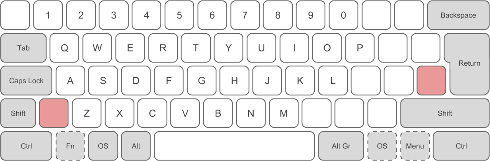
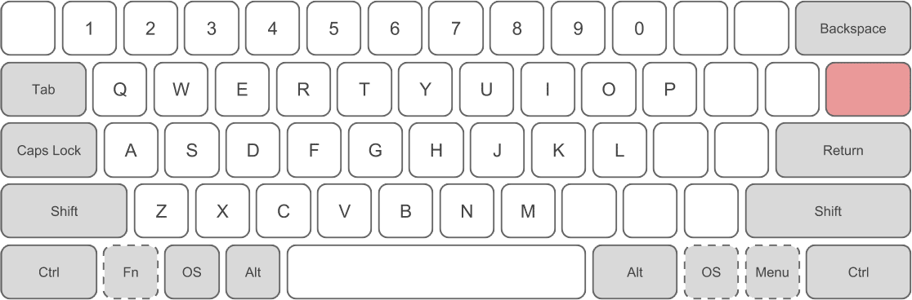
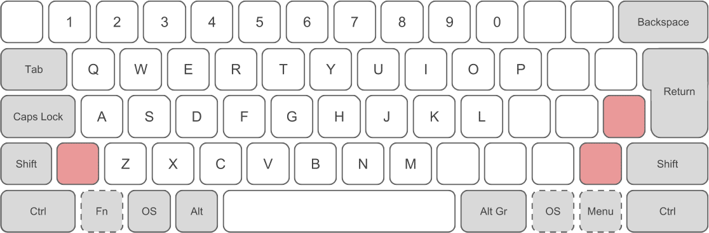
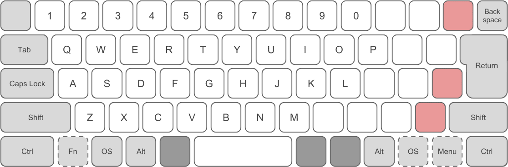
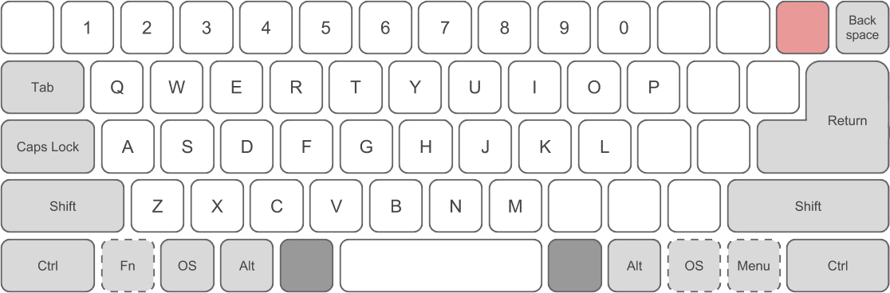
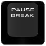
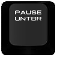
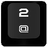
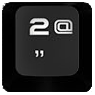

# Keyboard layouts
On top regular [RGB.NET layouts](/guides/developer/layouts) Artemis introduces two more concept specifically for keyboards called **physical** and **logical** layouts.

## Physical layouts
A physical layout determines where on the keyboard all the keys are located and what shape the keys have. Every RGB.NET layout has only one physical layout and is only compatible with keyboards of the same physical layout.

Two common layouts are **ISO** in Europe and **ANSI** in the US, however Artemis supports 5 layouts.

### ISO

### ANSI

### ABNT

### JIS

### KS

## Logical layouts
A logical layout determines what labels each key on the keyboard has. 
The same physical layout may have multiple logical layouts. A good example of this are German keyboards.

On an international keyboard there is a **PAUSE BREAK** button but on German keyboards that button says **PAUSE UNTBR**
 

A slightly more practical example is the **2** button, it also allows for double-quotes on a German keyboard.
 

> Logical layouts are a lot less important than physical layouts as this is just a minor detail. LED behaviour is unnaffected by logical layouts and it only determines how the keyboard looks in the profile editor.
{.is-info}
