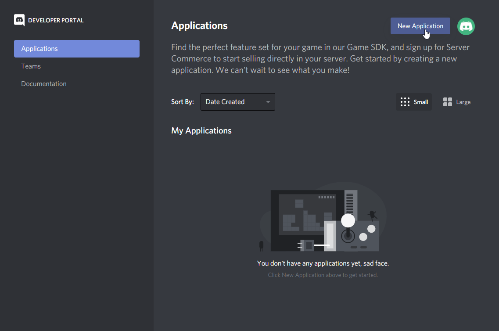
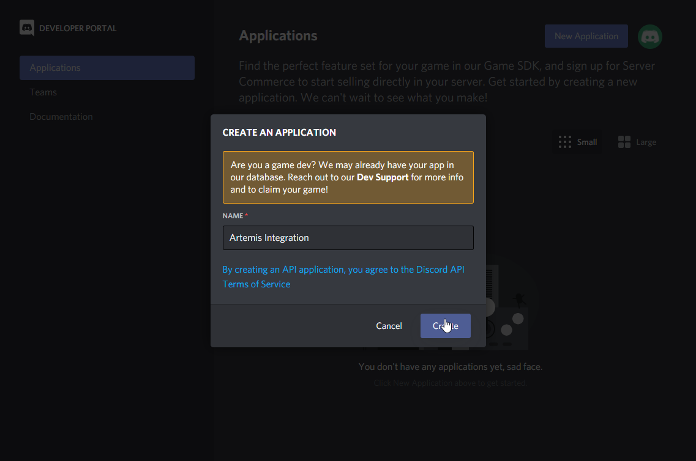
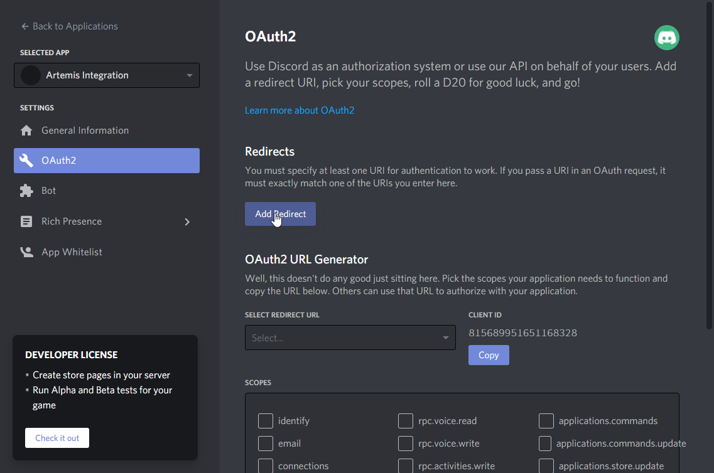
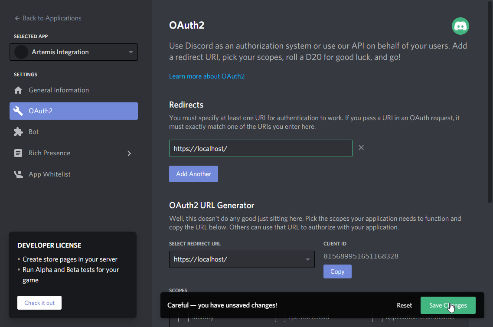
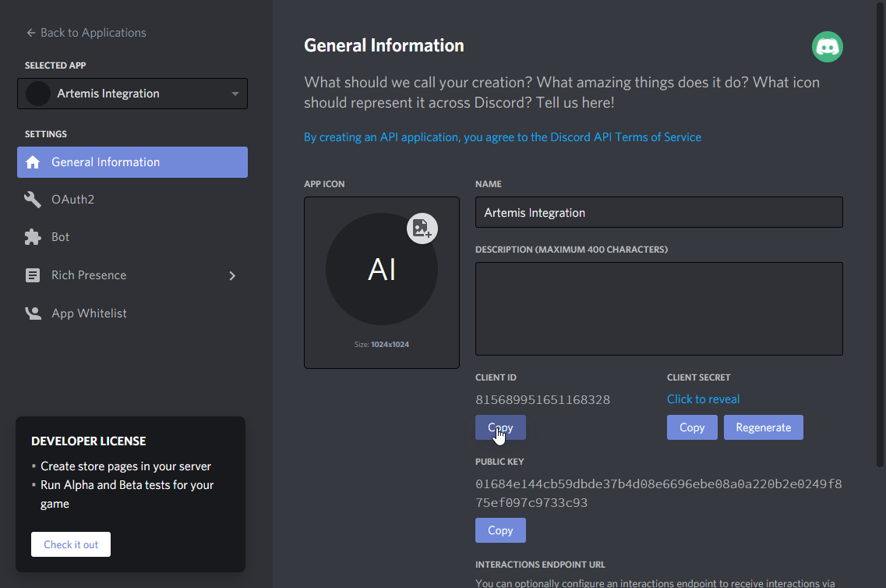
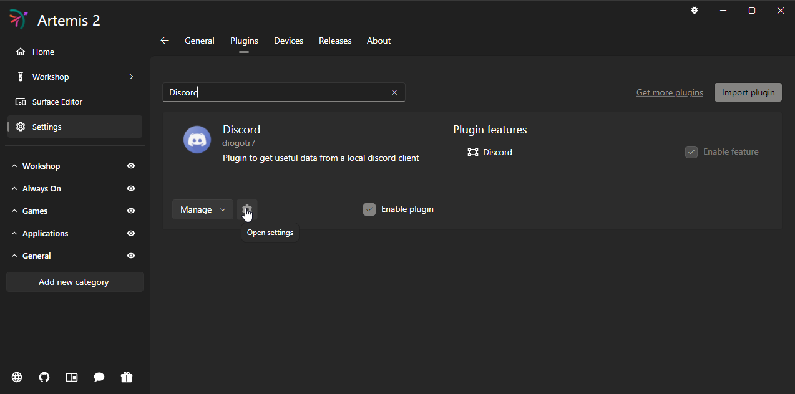
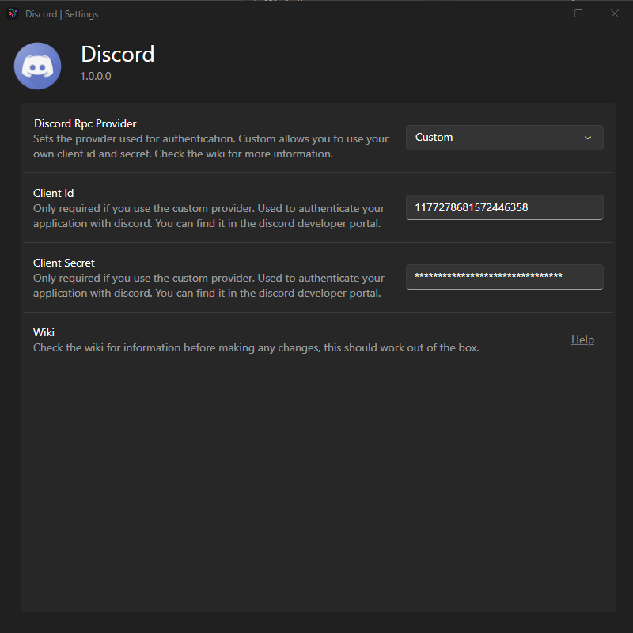
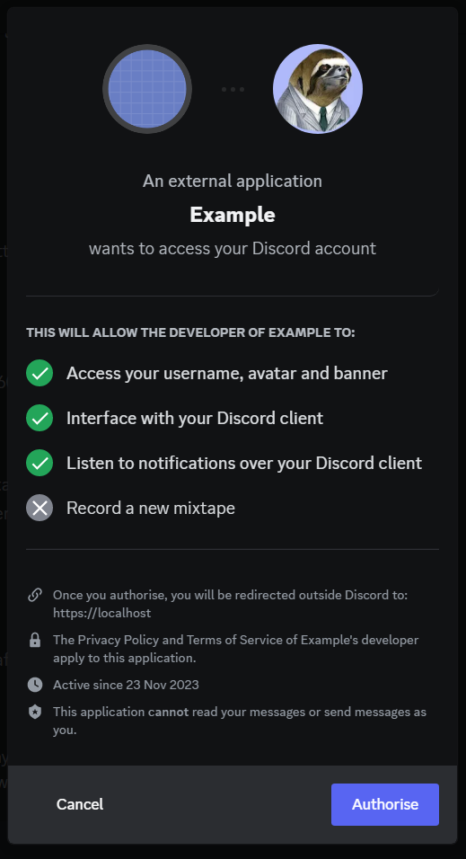

# Discord Integration

## Installation
1. [Download](https://nightly.link/diogotr7/Artemis.Plugins/workflows/dotnet-core/master/Discord.zip) the plugin.
2. Import it into Artemis
3. Accept the popup in Discord
4. Done!

In case the above does not work, follow the rest of the instructions. This should not be needed unless Discord breaks something.

## Custom Setup Instructions

This integration should work right out of the box when installed, but as a fallback a custom Discord API App can be used. Most users do NOT need to do this, but if you do follow the instructions below

1. Download the latest version of the [Discord plugin](https://nightly.link/diogotr7/Artemis.Plugins/workflows/dotnet-core/master/Discord.zip) and save it anywhere to your PC
2. Import the plugin via **Settings** > **Plugins** > **Import plugin**
3. Go to the [Discord Developer Portal](https://discord.com/developers/applications).
4. Create a new Application.

5. Name it something you'll remember - "Artemis Integration" works fine. Click Create.

6. Optional - If you want, add an icon and fill in the description.
7. Go to the "OAuth2" tab ,click "Add Redirect" and paste `https://localhost/` *exactly*.

8. Click "Save Changes".

9. Here you'll also find the Client ID and Client Secret. Click on the "Copy" button under Client ID

10. Open Artemis, go into settings, and select the "Plugins" tab.
11. Look for the Discord Plugin and click the "Settings" button.

12. Select the Rpc type "Custom"
13. Paste the Client Id and Secret you got from above.

14. Close the dialog
15. Authorise the request in the Discord window:

16. Done!
