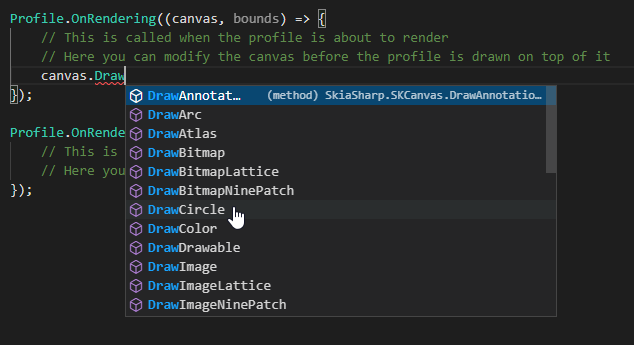

> Scripting is not a widely supported feature, we recommend you use the [node system](/guides/user/profiles/nodes) instead
{.is-warning}

> This guide assumes you are using the default JavaScript scripting provider.
{.is-info}

# Introduction
While Artemis offers loads of customizability via it's UI, there will always be limits to what you can do.
To help overcome some of these limits without the need of an entire plugin, you can choose to write a script.

By default Artemis ships with a [JavaScript](https://developer.mozilla.org/en-US/docs/Web/JavaScript) scripting provider. This provider uses the [JINT JavaScript engine](https://github.com/sebastienros/jint) providing almost full EcmaScript 2023 support.

## Creating a script
1. Ensure the **JavaScript Scripting Provider** plugin is enabled
2. Open a profile to which you'd like to add a script
3. Click **File** > **View Scripts**
4. Click on the **Add new script** button
5. Give your script a name
6. Click on Open editor to open the script editor in your browser

The default script has these contents.  
Use IntelliSense auto-complete (<kbd>ctrl</kbd>+<kbd>space</kbd>) to get more info about the available APIs.

```js
// The full profile is available via the GetProfile() function
const profile = Profile.GetProfile();

Profile.OnUpdating((deltaTime) => {
    // This is called each time the profile is about to update
});

Profile.OnUpdated((deltaTime) => {
    // This is called each time the profile has updated
});

Profile.OnRendering((canvas, bounds) => {
    // This is called when the profile is about to render
    // Here you can modify the canvas before the profile is drawn on top of it
});

Profile.OnRendered((canvas, bounds) => {
    // This is called when the profile has rendered
    // Here you can modify the canvas after the profile is drawn
});
```

## Drawing to the profile
To draw to a profile add a callback to `Profile.OnRendering` as shown in the example below. From there you can use the different methods on `canvas` to manipulate the profile.


The canvas is a SkiaSharp canvas, you can learn more about the SkiaSharp API here:
https://learn.microsoft.com/en-us/xamarin/xamarin-forms/user-interface/graphics/skiasharp/basics/circle